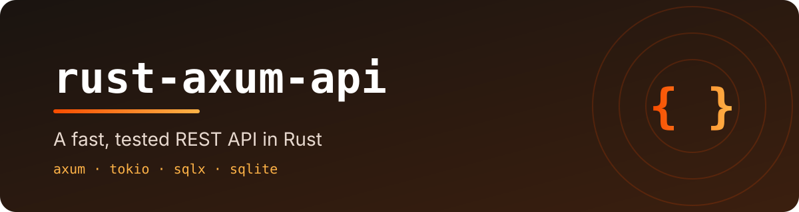
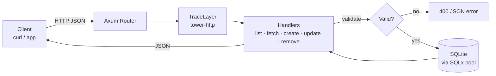
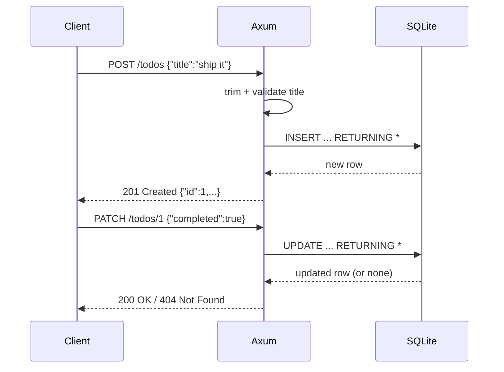

<p align="center">
  
</p>

<p align="center">
  <a href="https://github.com/anqorithm/rust-axum-api/actions/workflows/ci.yml"></a>
  <a href="https://github.com/anqorithm/rust-axum-api/releases/latest"></a>
  <a href="LICENSE"></a>
  
  
  
  
</p>

A REST API for todos, built with Rust, [Axum](https://github.com/tokio-rs/axum), SQLx and SQLite.

## Features

- Full CRUD for `/todos` plus a `/health` check
- SQLite storage with migrations that run on startup
- Input validation and consistent JSON errors
- Request tracing with `tower-http`
- Integration tests and CI (fmt, clippy, tests)

## Architecture



## Request flow



## Install

**Prebuilt binary** (Linux x86_64, macOS Apple Silicon, Windows) from the [latest release](https://github.com/anqorithm/rust-axum-api/releases/latest):

```sh
curl -L https://github.com/anqorithm/rust-axum-api/releases/latest/download/rust-axum-api-v0.1.0-x86_64-unknown-linux-gnu.tar.gz | tar xz
./rust-axum-api-v0.1.0-x86_64-unknown-linux-gnu/rust-axum-api
```

**Docker:**

```sh
docker run -p 3000:3000 -v todos:/data ghcr.io/anqorithm/rust-axum-api:latest
```

## Run from source

```sh
cargo run   # listens on 0.0.0.0:3000, creates todos.db and runs migrations
```

| Env var        | Default              |
|----------------|----------------------|
| `DATABASE_URL` | `sqlite://todos.db`  |
| `ADDR`         | `0.0.0.0:3000`       |
| `RUST_LOG`     | unset                |

## Endpoints

| Method | Path          | Body                                    | Response      |
|--------|---------------|-----------------------------------------|---------------|
| GET    | `/health`     |                                         | `200 ok`      |
| GET    | `/todos`      |                                         | `200` list    |
| POST   | `/todos`      | `{"title": "..."}`                      | `201` todo    |
| GET    | `/todos/{id}` |                                         | `200` / `404` |
| PATCH  | `/todos/{id}` | `{"title"?: "...", "completed"?: bool}` | `200` / `404` |
| DELETE | `/todos/{id}` |                                         | `204` / `404` |

Titles are trimmed and must be 1-200 characters.

## Examples

```console
$ curl -X POST localhost:3000/todos -H 'content-type: application/json' -d '{"title":"ship it"}'
{"id":1,"title":"ship it","completed":false,"created_at":"2026-11-21T15:26:31Z"}

$ curl -X PATCH localhost:3000/todos/1 -H 'content-type: application/json' -d '{"completed":true}'
{"id":1,"title":"ship it","completed":true,"created_at":"2026-11-21T15:26:31Z"}

$ curl localhost:3000/todos/42
{"error":"todo not found"}
```

## Project layout

```text
.
├── migrations/0001_create_todos.sql   # schema
├── src/lib.rs                         # router, handlers, errors
├── src/main.rs                        # config, DB pool, server
└── tests/api.rs                       # integration tests
```

## Test

```sh
cargo test
```

## Releasing

Releases follow [SemVer](https://semver.org). Add a section to [CHANGELOG.md](CHANGELOG.md), bump `version` in `Cargo.toml`, merge to `main`, then tag:

```sh
git tag v0.2.0 && git push origin v0.2.0
```

The [release workflow](.github/workflows/release.yml) builds the binaries, pushes the Docker image to GHCR and publishes the GitHub release with checksums.

## License

[MIT](LICENSE)
